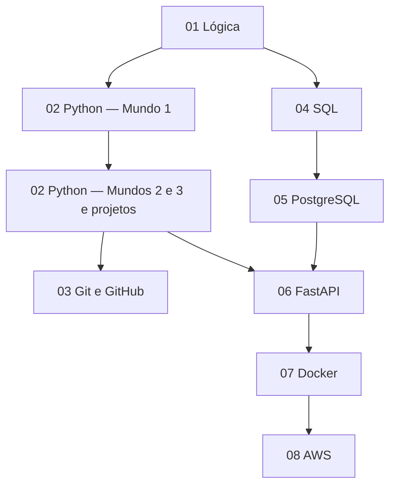

# Roadmap — asklipe Back-End Roadmap

[Início](README.md) · [Study Tracker](STUDY-TRACKER.md) · [Resources](RESOURCES.md)

> Cada módulo só deve ser marcado como concluído quando o **critério de conclusão** dele for cumprido. Tecnologias futuras **não** são apresentadas como conhecimento dominado. Seu progresso fica no [Study Tracker](STUDY-TRACKER.md).

## Visão geral

A ordem recomendada é a numérica (01 → 08). O diagrama mostra só o que é pré-requisito de verdade.

## Sequência de estudo

| Módulo | Etapa | Professor / canal | Depende de | Pronto quando... |
|:------:|-------|-------------------|:----------:|------------------|
| [01](01-programming-logic/README.md) | Lógica de programação | Gustavo Guanabara | — | Escrevo algoritmos com condições e repetições. |
| [02](02-python/world-01/README.md) | Python básico (Mundo 1) | Gustavo Guanabara | 01 | Resolvo os exercícios do Mundo 1 sozinho. |
| [02](02-python/README.md) | Python intermediário (Mundos 2 e 3) | Gustavo Guanabara | 02 · Mundo 1 | Uso estruturas compostas, funções, módulos e erros; 4 projetos concluídos. |
| [03](03-git-github/README.md) | Git e GitHub | Gustavo Guanabara | 02 | Versiono tudo, uso branches e pull requests e publico os 4 projetos de Python. |
| [04](04-sql-databases/README.md) | SQL | Bóson Treinamentos | 01 | Escrevo CRUD e `JOIN` e modelo dados. |
| [05](05-postgresql/README.md) | PostgreSQL | Bóson Treinamentos | 04 | Banco rodando, com índices e integração com Python. |
| [06](06-fastapi/README.md) | FastAPI | Eduardo Mendes (Dunossauro) | 02, 05 | API com banco, autenticação e testes. |
| [07](07-docker/README.md) | Docker | Jeferson Fernando / LINUXtips | 06 | API e banco em contêineres com Compose. |
| [08](08-aws-cloud/README.md) | AWS | Mundo da Cloud | 07 | API publicada na nuvem com custos controlados. |

## Por que esta ordem?

1. **Lógica antes de Python:** a linguagem fica mais fácil quando o raciocínio já existe.
2. **Git logo após o Python intermediário:** os projetos de Python são concluídos primeiro e publicados no GitHub ao aprender Git; tudo o que vem depois já nasce versionado.
3. **SQL e PostgreSQL antes de FastAPI:** a API precisa de persistência para ser útil.
4. **Docker antes de AWS:** contêineres tornam o deploy na nuvem reproduzível.

## Marcos

- **Marco 1 — Programador:** módulos 01 a 03 concluídos e 4 projetos iniciantes publicados.
- **Marco 2 — Dados:** módulos 04 e 05 concluídos e CRUD com PostgreSQL publicado.
- **Marco 3 — API:** módulo 06 concluído com API de autenticação publicada.
- **Marco 4 — Produção:** módulos 07 e 08 concluídos e API publicada na nuvem.

## Revisão

Reavalie este roadmap a cada marco. Se um módulo exigir mais tempo, ajuste a ordem aqui e registre o motivo nas observações do [Study Tracker](STUDY-TRACKER.md).
