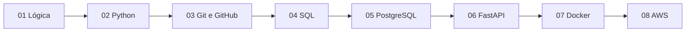

<div align="center">


[](https://github.com/asklipe)

[Painel](https://asklipe.github.io/learn-asklipe/) · [Roadmap](ROADMAP.md) · [Progresso](STUDY-TRACKER.md) · [Estudar com IA](AI-SETUP.md) · [Recursos](RESOURCES.md) · [Contribuindo](CONTRIBUTING.md)

</div>

---

Gostaria de registrar algumas das minhas experiências e aprendizados para vocês começarem a estudar também. Vou deixar tudo documentado aqui, gafanhotos! Isso é uma parte do que aprendi e estudei ao longo dos meus seis anos de carreira, e serve como base para vocês darem os primeiros passos. Beleza?

## O que é este repositório?

Uma trilha de estudos de **Back-End** com ordem definida, aulas em vídeo gratuitas em português, exercícios, projetos e um critério claro de quando você pode avançar de módulo.

E ela conversa com a sua IA: com o repositório aberto no assistente, ele lê o seu progresso, prepara a aula, acompanha você **enquanto assiste** e registra o que você realmente estudou.

## Comece em 3 passos

1. **[Faça um fork](https://github.com/asklipe/learn-asklipe/fork).** O seu progresso fica no seu fork, sem mexer no original.
2. **Abra o fork com a sua IA** e peça para ela ler o [`AI-BOOTSTRAP.md`](AI-BOOTSTRAP.md). Ferramentas como Claude Code, GitHub Copilot, Codex, Cursor e Gemini CLI carregam as instruções sozinhas quando o repositório está aberto nelas. Em chats sem acesso ao repositório, conecte o GitHub pela integração da plataforma ou use o prompt inicial do [AI-SETUP.md](AI-SETUP.md). A autorização do GitHub é sempre sua.
3. **Diga o que vai assistir.** Exemplo: *"Vou assistir a aula 04 do Mundo 1 de Python."* A IA prepara, acompanha e registra.

## Para quem é este roadmap?

- Quer entrar na área de **desenvolvimento back-end**
- Não tem experiência prévia em programação
- Prefere aprender com **cursos gratuitos em português**
- Quer uma trilha com **começo, meio e fim bem definidos**

> Se essa é a sua situação, você está no lugar certo. Comece pelo módulo 01 e siga a ordem.

## Objetivo

Atuar como **Back-End Developer**, construindo APIs seguras, bem testadas e prontas para produção.

## Tecnologias

<div align="center">
  
</div>

## Visão geral da jornada



> Dependências reais e justificativa da ordem em [ROADMAP.md](ROADMAP.md).

## Módulos e aulas em vídeo

Clique na thumbnail para assistir no YouTube.

---

### 01 — Lógica de Programação

**Professor:** Gustavo Guanabara — Curso em Vídeo

[](https://www.youtube.com/watch?v=8mei6uVttho)

**Por que começar aqui?** Antes de qualquer linguagem, você precisa aprender a pensar como programador. Lógica é a base de tudo — pule essa etapa e vai sentir dificuldade em todos os módulos seguintes.

[](https://www.youtube.com/playlist?list=PLHz_AreHm4dmSj0MHol_aoNYCSGFqvfXV)

---

### 02 — Python (Mundos 1, 2 e 3)


**Professor:** Gustavo Guanabara — Curso em Vídeo

[](https://www.youtube.com/watch?v=S9uPNppGsGo)

[](https://www.youtube.com/playlist?list=PLHz_AreHm4dlKP6QQCekuIPky1CiwmdI6)
[](https://www.youtube.com/playlist?list=PLHz_AreHm4dk_nZHmxxf_J0WRAqy5Czye)
[](https://www.youtube.com/playlist?list=PLHz_AreHm4dksnH2jVTIVNviIMBVYyFnH)

---

### 03 — Git e GitHub


**Professor:** Gustavo Guanabara — Curso em Vídeo

[](https://www.youtube.com/watch?v=xEKo29OWILE)

**Por que Git aqui?** A partir deste ponto, tudo que você produzir deve ser versionado. Git é a ferramenta padrão do mercado — sem ela você não trabalha em equipe.

[](https://www.youtube.com/playlist?list=PLHz_AreHm4dm7ZULPAmadvNhH6vk9oNZA)

---

### 04 — SQL e Bancos de Dados


**Canal:** Bóson Treinamentos

[](https://www.youtube.com/watch?v=G8rKr4G5ZKM)

[](https://www.youtube.com/@bosontreinamentos)

---

### 05 — PostgreSQL


**Canal:** Bóson Treinamentos

[](https://www.youtube.com/@bosontreinamentos)

---

### 06 — FastAPI


**Professor:** Eduardo Mendes (Dunossauro)

[](https://www.youtube.com/watch?v=QdSMYGEMFsM)

[](https://www.youtube.com/playlist?list=PLOQgLBuj2-3IuFbt-wJw2p2NiV9WTRzIP)
[](https://fastapidozero.dunossauro.com/)

---

### 07 — Docker


**Professor:** Jeferson Fernando — LINUXtips

[](https://www.youtube.com/@LINUXtips)
[](https://github.com/badtuxx/DescomplicandoDocker)

---

### 08 — AWS Cloud


**Canal:** Mundo da Cloud + AWS Skill Builder

[](https://skillbuilder.aws/)

---

## Painel interativo

O arquivo [`index.html`](index.html) é um painel de estudos que roda no navegador, sem instalar nada: cards por módulo, checklist de aulas e exercícios, anotações, timer de foco de 25 minutos, tema claro e escuro e botão **Exportar**, que gera o seu progresso em Markdown para colar no [STUDY-TRACKER.md](STUDY-TRACKER.md).

- Cada módulo tem uma galeria de vídeos e playlists que tocam no próprio painel. O player fica fixo no canto da tela enquanto você marca os exercícios.
- O progresso do painel fica salvo **só no navegador** em que você marcou. O `STUDY-TRACKER.md` continua sendo o registro oficial.
- Para publicar o painel com um link seu, ative o GitHub Pages: *Settings → Pages → Deploy from a branch → `main` / `(root)`*. O endereço será `https://SEU-USUARIO.github.io/learn-asklipe/`.
- O botão **IA** de cada item abre um parceiro de estudos. Dentro do Claude ele responde na hora; em qualquer outro lugar ele copia um prompt pronto para você colar na sua IA.

## Estudar com IA (assistindo)

| Quando | O que a IA faz |
|--------|----------------|
| **Antes da aula** | Mostra o objetivo, a duração e 3 perguntas para você pensar enquanto assiste. |
| **Durante** | Tira dúvidas no ponto em que você pausou, a partir das suas anotações ou da transcrição que você colar. |
| **Depois** | Faz um mini-quiz, sugere um exercício e propõe uma nota de estudo. |
| **Registro** | Atualiza o [STUDY-TRACKER](STUDY-TRACKER.md) e o [AI-STUDY-LOG](AI-STUDY-LOG.md), **só com a sua confirmação**. |

A IA não finge ter assistido ao vídeo, não marca nada como concluído por conta própria e não escreve no repositório original. Arquivos do repositório orientam a IA, mas não autenticam contas nem gravam na memória dela. Detalhes e prompts prontos em [AI-SETUP.md](AI-SETUP.md).

## Seu progresso

O progresso fica em um único lugar: o [STUDY-TRACKER.md](STUDY-TRACKER.md), no seu fork.

| Marco | O que significa | Módulos |
|-------|----------------|---------|
| Programador | Você escreve código e versiona projetos | 01 → 03 |
| Dados | Você modela e consulta bancos de dados | 04 → 05 |
| API | Você constrói APIs com autenticação e testes | 06 |
| Produção | Você sobe sua API na nuvem | 07 → 08 |

## Projetos práticos

| Nível | Projeto | Onde |
|-------|---------|------|
| Iniciante | Calculadora em Python | [02-python/projects](02-python/projects/README.md) |
| Iniciante | Conversor de moedas | [02-python/projects](02-python/projects/README.md) |
| Iniciante | Sistema de cadastro | [02-python/projects](02-python/projects/README.md) |
| Iniciante | Gerenciador de tarefas em terminal | [02-python/projects](02-python/projects/README.md) |
| Intermediário | CRUD com PostgreSQL | [05-postgresql/projects](05-postgresql/projects/README.md) |
| Intermediário | API de tarefas com FastAPI | [06-fastapi/projects](06-fastapi/projects/README.md) |
| Intermediário | API com autenticação | [06-fastapi/projects](06-fastapi/projects/README.md) |
| Avançado | API completa FastAPI + PostgreSQL | [06-fastapi/projects](06-fastapi/projects/README.md) |
| Avançado | Aplicação com Docker Compose | [07-docker/projects](07-docker/projects/README.md) |
| Avançado | Deploy de API na AWS | [08-aws-cloud/projects](08-aws-cloud/projects/README.md) |

## Documentação oficial

- [Git](https://git-scm.com/doc) · [GitHub Docs](https://docs.github.com/pt)
- [PostgreSQL Tutorial](https://www.postgresql.org/docs/current/tutorial.html)
- [FastAPI Tutorial](https://fastapi.tiangolo.com/tutorial/)
- [Docker — Get started](https://docs.docker.com/get-started/)
- [AWS Skill Builder](https://skillbuilder.aws/)

Lista completa com status de verificação em [RESOURCES.md](RESOURCES.md).

## Estrutura do repositório

```text
learn-asklipe/
├── README.md                 ← você está aqui
├── index.html                ← painel interativo (GitHub Pages)
├── ROADMAP.md                ← trilha detalhada com dependências
├── STUDY-TRACKER.md          ← seu progresso (fonte única)
├── RESOURCES.md              ← links e status de verificação
├── CONTRIBUTING.md           ← como contribuir
├── AI-BOOTSTRAP.md           ← ponto de entrada da IA (leitura obrigatória)
├── AI-ASSISTANT.md           ← contrato do tutor de IA
├── AI-SETUP.md               ← guia para você: conectar e estudar com IA
├── AI-STUDY-LOG.md           ← histórico das sessões com IA
├── AGENTS.md · CLAUDE.md · GEMINI.md  ← carregados pelas ferramentas
├── .github/
│   ├── copilot-instructions.md
│   ├── skills/learn-script-study-assistant/SKILL.md
│   └── workflows/check-links.yml
├── study/notes/              ← suas anotações por aula
├── scripts/check_links.py    ← confere links e IDs de vídeo
├── 01-programming-logic/
├── 02-python/
├── 03-git-github/
├── 04-sql-databases/
├── 05-postgresql/
├── 06-fastapi/
├── 07-docker/
├── 08-aws-cloud/
└── assets/images/banner.svg
```

## Quer conversar ou tirar dúvida?

Abra uma [Issue](../../issues/new) neste repositório. Se você seguiu o fork, lembre que o GitHub deixa as Issues desligadas em forks por padrão; ative em *Settings → Features*. Dúvidas de estudo você também pode resolver direto com a sua IA.

---

<div align="center">

*"Programação é arte disfarçada de ciência. Quanto mais você quebrar a cabeça, mais lindo o código fica."*

[](https://github.com/asklipe)

</div>
