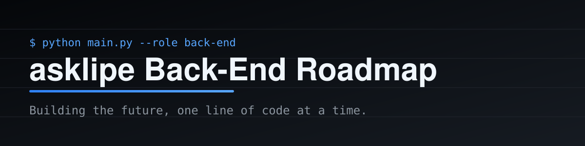
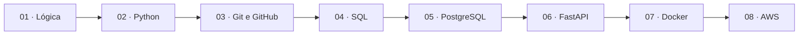

<div align="center">



# Learn Script · Back-End Roadmap

**A trilha de estudos que asklipe organizou para aprender e compartilhar desenvolvimento Back-End.**

[](https://github.com/asklipe)
[](https://github.com/asklipe)
[](ROADMAP.md)
[](#)

[Roadmap](ROADMAP.md) · [Acompanhamento](STUDY-TRACKER.md) · [Recursos](RESOURCES.md) · [Assistente de IA](AI-ASSISTANT.md) · [Como contribuir](CONTRIBUTING.md)

</div>

---

## O que é o Learn Script?

O **Learn Script** é a trilha pública de estudos de **asklipe**. Este repositório reúne os cursos, aulas, documentações, exercícios, projetos e critérios que compõem a jornada de aprendizado apresentada por ele.

A ideia é compartilhar um caminho real e organizado: quem quiser estudar os mesmos assuntos pode fazer um fork, seguir a sequência e adaptar o acompanhamento à própria evolução. O repositório não promete transformar ninguém em profissional automaticamente; ele oferece uma estrutura de estudo, prática e registro.

**Importante:** o conteúdo-base e a seleção de materiais representam a trilha publicada por asklipe. Ao fazer um fork, você cria sua própria cópia para registrar seu progresso, sem alterar o repositório original.

## Quem mantém

| Campo | Informação |
|---|---|
| Projeto | Learn Script |
| Admin / mantenedor | **asklipe** |
| GitHub | [@asklipe](https://github.com/asklipe) |
| Foco | Desenvolvimento Back-End |
| Linguagem central da trilha | Python |
| Idioma | Português (Brasil) |

Issues e contribuições devem respeitar o escopo e as diretrizes deste repositório. A administração do projeto original pertence a asklipe; cada pessoa administra o próprio fork.

## Para quem é esta trilha?

- Para quem quer estudar os mesmos fundamentos e tecnologias da jornada publicada por asklipe.
- Para quem está começando ou quer organizar melhor a base de Back-End.
- Para quem prefere materiais gratuitos, especialmente em português.
- Para quem quer aprender fazendo exercícios e projetos, não apenas assistindo a vídeos.
- Para quem deseja usar uma IA conectada ao GitHub para acompanhar e registrar a própria evolução.

## Jornada de estudos



A sequência completa, as dependências e os critérios de avanço estão em [ROADMAP.md](ROADMAP.md).

## Stack estudada

<div align="center">
<a href="https://www.python.org/"></a>&nbsp;&nbsp;
<a href="https://fastapi.tiangolo.com/"></a>&nbsp;&nbsp;
<a href="https://www.postgresql.org/"></a>&nbsp;&nbsp;
<a href="https://www.mysql.com/"></a>&nbsp;&nbsp;
<a href="https://www.docker.com/"></a>&nbsp;&nbsp;
<a href="https://git-scm.com/"></a>&nbsp;&nbsp;
<a href="https://github.com/"></a>&nbsp;&nbsp;
<a href="https://aws.amazon.com/"></a>
</div>

## Cursos, vídeos e previews

As capas abaixo são thumbnails públicas do YouTube. Clique em uma capa para abrir o vídeo; os links de playlist levam à sequência completa. O título exibido identifica o material indicado na trilha. Quando um vídeo individual ou uma playlist ainda não foi confirmado, isso fica sinalizado no respectivo módulo — não inventamos IDs, títulos ou links para preencher lacunas.

<details open>
<summary><strong>01 · Lógica de Programação</strong> — Gustavo Guanabara / Curso em Vídeo</summary>

**Curso:** [Curso de Algoritmos e Lógica de Programação](https://www.cursoemvideo.com/curso/curso-de-algoritmo/)

[](https://www.youtube.com/watch?v=8mei6uVttho)

- [Abrir vídeo de introdução](https://www.youtube.com/watch?v=8mei6uVttho)
- [Playlist completa](https://www.youtube.com/playlist?list=PLHz_AreHm4dmSj0MHol_aoNYCSGFqvfXV)
- [Conteúdo e exercícios](01-programming-logic/README.md)

</details>

<details open>
<summary><strong>02 · Python — Mundos 1, 2 e 3</strong> — Gustavo Guanabara / Curso em Vídeo</summary>

[](https://www.youtube.com/watch?v=S9uPNppGsGo)

- [Python — Mundo 1](https://www.youtube.com/playlist?list=PLHz_AreHm4dlKP6QQCekuIPky1CiwmdI6)
- [Python — Mundo 2](https://www.youtube.com/playlist?list=PLHz_AreHm4dk_nZHmxxf_J0WRAqy5Czye)
- [Python — Mundo 3](https://www.youtube.com/playlist?list=PLHz_AreHm4dksnH2jVTIVNviIMBVYyFnH)
- [Aula inicial do Mundo 1](https://www.youtube.com/watch?v=S9uPNppGsGo)
- [Conteúdo, mundos e projetos](02-python/README.md)

</details>

<details open>
<summary><strong>03 · Git e GitHub</strong> — Gustavo Guanabara / Curso em Vídeo</summary>

[](https://www.youtube.com/watch?v=xEKo29OWILE)

- [Playlist completa](https://www.youtube.com/playlist?list=PLHz_AreHm4dm7ZULPAmadvNhH6vk9oNZA)
- [Aula inicial](https://www.youtube.com/watch?v=xEKo29OWILE)
- [Curso no site do Curso em Vídeo](https://www.cursoemvideo.com/curso/curso-de-git-e-github/)
- [Conteúdo do módulo](03-git-github/README.md)

</details>

<details open>
<summary><strong>04 · SQL e Bancos de Dados</strong> — Bóson Treinamentos</summary>

[](https://www.youtube.com/watch?v=G8rKr4G5ZKM)

- [Vídeo de referência](https://www.youtube.com/watch?v=G8rKr4G5ZKM)
- [Canal Bóson Treinamentos](https://www.youtube.com/@bosontreinamentos)
- [Conteúdo, exercícios e links com status de verificação](04-sql-databases/README.md)

</details>

<details open>
<summary><strong>05 · PostgreSQL</strong> — Bóson Treinamentos</summary>

- [Canal Bóson Treinamentos](https://www.youtube.com/@bosontreinamentos)
- [Documentação oficial — Tutorial PostgreSQL](https://www.postgresql.org/docs/current/tutorial.html)
- [Conteúdo e materiais do módulo](05-postgresql/README.md)

> A playlist específica de PostgreSQL permanece pendente de confirmação nos materiais deste repositório. Consulte o módulo para não confundir materiais gerais do canal com uma playlist validada.

</details>

<details open>
<summary><strong>06 · FastAPI do Zero</strong> — Eduardo Mendes / Dunossauro</summary>

[](https://www.youtube.com/watch?v=QdSMYGEMFsM)

- [Playlist FastAPI do Zero](https://www.youtube.com/playlist?list=PLOQgLBuj2-3IuFbt-wJw2p2NiV9WTRzIP)
- [Aula de referência](https://www.youtube.com/watch?v=QdSMYGEMFsM)
- [Curso escrito](https://fastapidozero.dunossauro.com/)
- [Conteúdo e projetos](06-fastapi/README.md)

</details>

<details open>
<summary><strong>07 · Docker</strong> — Jeferson Fernando / LINUXtips</summary>

- [Canal LINUXtips](https://www.youtube.com/@LINUXtips)
- [Livro aberto — Descomplicando o Docker](https://github.com/badtuxx/DescomplicandoDocker)
- [Conteúdo e projetos](07-docker/README.md)

> O módulo contém os itens de vídeo e materiais com o respectivo status de verificação.

</details>

<details open>
<summary><strong>08 · AWS Cloud</strong> — Mundo da Cloud + AWS Skill Builder</summary>

- [AWS Skill Builder](https://skillbuilder.aws/)
- [Conteúdo, trilha e projetos](08-aws-cloud/README.md)

> Consulte o módulo para distinguir recursos oficiais e links de terceiros ainda não confirmados.

</details>

## Acompanhamento do progresso

O status inicial dos módulos no repositório-base é **não iniciado**. No seu fork, atualize o [STUDY-TRACKER.md](STUDY-TRACKER.md) à medida que estudar.

| Status | Significado |
|:---:|---|
| 🔴 | Não iniciado |
| 🟡 | Em andamento |
| 🟢 | Concluído |
| ⏸️ | Pausado |

| # | Módulo | Tracker |
|:--:|---|---|
| 01 | Lógica de programação | [Abrir](01-programming-logic/README.md) |
| 02 | Python — Mundos 1, 2 e 3 | [Abrir](02-python/README.md) |
| 03 | Git e GitHub | [Abrir](03-git-github/README.md) |
| 04 | SQL e bancos de dados | [Abrir](04-sql-databases/README.md) |
| 05 | PostgreSQL | [Abrir](05-postgresql/README.md) |
| 06 | FastAPI | [Abrir](06-fastapi/README.md) |
| 07 | Docker | [Abrir](07-docker/README.md) |
| 08 | AWS Cloud | [Abrir](08-aws-cloud/README.md) |

## Como começar: faça um fork

1. Abra o repositório original do Learn Script no GitHub: [github.com/asklipe](https://github.com/asklipe).
2. Entre no repositório do projeto e clique em **Fork**.
3. Escolha sua conta como destino. O GitHub criará uma cópia independente sob seu usuário.
4. Clone o seu fork ou abra-o diretamente no GitHub.
5. Estude seguindo a ordem do [ROADMAP.md](ROADMAP.md).
6. Registre seu avanço no [STUDY-TRACKER.md](STUDY-TRACKER.md).
7. Se quiser usar uma IA, conecte sua conta GitHub à plataforma escolhida e dê acesso explícito ao seu fork.

**Atenção:** não peça para a IA alterar o repositório original `asklipe`. O alvo deve ser o fork que pertence a você.

## Skill de IA — Learn Script Study Assistant

O Learn Script inclui uma especificação de skill independente de fornecedor para que diferentes assistentes possam entender a estrutura da trilha e ajudar no acompanhamento.

A skill permite que uma IA conectada ao GitHub:

- leia o roadmap, módulos, exercícios e tracker do fork autorizado;
- explique o próximo passo com base no progresso registrado;
- transforme uma sessão de estudo relatada por você em atualizações no tracker;
- registre o que foi estudado, concluído, revisado ou ficou pendente;
- apresente um resumo claro das alterações que pretende fazer;
- grave as mudanças no seu fork quando a integração GitHub permitir escrita e você autorizar a ação.

**Arquivos e instruções:** [AI-ASSISTANT.md](AI-ASSISTANT.md) · [Skill portátil](.github/skills/learn-script-study-assistant/SKILL.md) · [Especificação de integração](.github/skills/learn-script-study-assistant/INTEGRATION.md).

### Como usar com ChatGPT, Claude, Gemini ou outra IA

1. Faça fork deste repositório para sua conta.
2. Conecte o GitHub à IA escolhida. A conexão precisa permitir acesso ao seu fork; para gravar alterações, precisa também ter permissão de escrita.
3. Abra uma conversa com a IA e informe o endereço do seu fork.
4. Forneça a skill deste repositório ou peça à IA para ler `.github/skills/learn-script-study-assistant/SKILL.md`.
5. Peça para ela analisar seu progresso. Depois de estudar, conte o que fez e peça para atualizar o tracker.
6. Revise o diff e autorize a gravação. Quando a plataforma não oferecer escrita direta, a IA deve preparar um patch ou commit para você aplicar.

A skill é uma **especificação de comportamento**, não uma conexão mágica. Cada plataforma precisa ter uma integração GitHub, ferramenta, MCP ou conector compatível e as permissões necessárias. Não existe garantia de que qualquer modelo, sozinho, consiga escrever no GitHub.

## Projetos práticos

| Nível | Projeto | Referência |
|---|---|---|
| Iniciante | Calculadora em Python | [Projetos Python](02-python/projects/README.md) |
| Iniciante | Conversor de moedas | [Projetos Python](02-python/projects/README.md) |
| Iniciante | Sistema de cadastro | [Projetos Python](02-python/projects/README.md) |
| Intermediário | CRUD com PostgreSQL | [Projetos PostgreSQL](05-postgresql/projects/README.md) |
| Intermediário | API de tarefas com FastAPI | [Projetos FastAPI](06-fastapi/projects/README.md) |
| Intermediário | API com autenticação | [Projetos FastAPI](06-fastapi/projects/README.md) |
| Avançado | API completa com FastAPI e PostgreSQL | [Projetos FastAPI](06-fastapi/projects/README.md) |
| Avançado | Aplicação com Docker Compose | [Projetos Docker](07-docker/projects/README.md) |
| Avançado | Deploy de API na AWS | [Projetos AWS](08-aws-cloud/projects/README.md) |

## Documentação oficial

- [Python](https://docs.python.org/3/)
- [Git](https://git-scm.com/doc) · [GitHub Docs](https://docs.github.com/pt)
- [PostgreSQL](https://www.postgresql.org/docs/current/tutorial.html)
- [FastAPI](https://fastapi.tiangolo.com/tutorial/)
- [Docker](https://docs.docker.com/get-started/)
- [AWS Skill Builder](https://skillbuilder.aws/)

## Estrutura

```text
backend-roadmap/
├── README.md
├── ROADMAP.md
├── STUDY-TRACKER.md
├── RESOURCES.md
├── AI-ASSISTANT.md
├── AI-STUDY-LOG.md
├── .github/
│   └── skills/
│       └── learn-script-study-assistant/
│           ├── SKILL.md
│           └── INTEGRATION.md
├── 01-programming-logic/
├── 02-python/
├── 03-git-github/
├── 04-sql-databases/
├── 05-postgresql/
├── 06-fastapi/
├── 07-docker/
└── 08-aws-cloud/
```

---

<div align="center">

**Learn Script** · Mantido por [asklipe](https://github.com/asklipe)

[GitHub do admin](https://github.com/asklipe) · [Abrir uma issue](../../issues/new)

</div>
