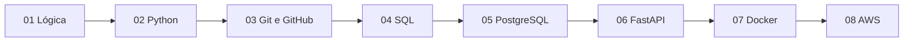

<div align="center">


---


[](https://github.com/asklipe)

[Roadmap](ROADMAP.md) · [Progresso](STUDY-TRACKER.md) · [Recursos](RESOURCES.md) · [Contribuindo](CONTRIBUTING.md)

</div>

---

## O que é este repositório?

Esta é a minha trilha de estudos real para me tornar Desenvolvedor Back-End.

Mas não fiz isso só para mim — organizei tudo aqui para que qualquer pessoa possa seguir o mesmo caminho. Se você quer entrar na área de Back-End e não sabe por onde começar, este é o lugar certo. Cada módulo tem objetivos claros, aulas em vídeo que você pode assistir diretamente por aqui, exercícios, projetos e um critério claro de quando você pode avançar.

---

## Para quem é este roadmap/rep?

Este guia foi pensado para quem:

- Quer entrar na área de **desenvolvimento back-end**
- Não tem experiência prévia em programação
- Prefere aprender com **cursos gratuitos em português**
- Quer uma trilha com **começo, meio e fim bem definidos**

> Se essa é a sua situação, você está no lugar certo. Comece pelo módulo 01 e siga a ordem.

---

## Objetivo 

Atuar como **Back-End Developer**, construindo APIs seguras, bem testadas e prontas para produção.

---

## Tecnologias


---

## Visão geral da jornada



> Detalhes e justificativa da ordem em [ROADMAP.md](ROADMAP.md).

---

## Módulos e aulas em vídeo

Clique na thumbnail para assistir no YouTube.

---

### 01 — Lógica de Programação

**Professor:** Gustavo Guanabara — Curso em Vídeo

[](https://www.youtube.com/watch?v=8mei6uVttho)

**Por que começar aqui?** Antes de qualquer linguagem, você precisa aprender a pensar como programador. Lógica é a base de tudo — pule essa etapa e vai sentir dificuldade em todos os módulos seguintes.

[](https://www.youtube.com/playlist?list=PLHz_AreHm4dmSj0MHol_aoNYCSGFqvfXV)

---

### 02 — Python (Mundos 1, 2 e 3)

**Professor:** Gustavo Guanabara — Curso em Vídeo

[](https://www.youtube.com/watch?v=S9uPNppGsGo)

[](https://www.youtube.com/playlist?list=PLHz_AreHm4dlKP6QQCekuIPky1CiwmdI6)
[](https://www.youtube.com/playlist?list=PLHz_AreHm4dk_nZHmxxf_J0WRAqy5Czye)
[](https://www.youtube.com/playlist?list=PLHz_AreHm4dksnH2jVTIVNviIMBVYyFnH)

---

### 03 — Git e GitHub

**Professor:** Gustavo Guanabara — Curso em Vídeo

[](https://www.youtube.com/watch?v=xEKo29OWILE)

**Por que Git aqui?** A partir deste ponto, tudo que você produzir deve ser versionado. Git é a ferramenta padrão do mercado — sem ela você não trabalha em equipe.

[](https://www.youtube.com/playlist?list=PLHz_AreHm4dm7ZULPAmadvNhH6vk9oNZA)

---

### 04 — SQL e Bancos de Dados

**Canal:** Bóson Treinamentos

[](https://www.youtube.com/watch?v=G8rKr4G5ZKM)

[](https://www.youtube.com/@bosontreinamentos)

---

### 05 — PostgreSQL

**Canal:** Bóson Treinamentos

[](https://www.youtube.com/@bosontreinamentos)

---

### 06 — FastAPI

**Professor:** Eduardo Mendes (Dunossauro)

[](https://www.youtube.com/watch?v=QdSMYGEMFsM)

[](https://www.youtube.com/playlist?list=PLOQgLBuj2-3IuFbt-wJw2p2NiV9WTRzIP)
[](https://fastapidozero.dunossauro.com/)

---

### 07 — Docker

**Professor:** Jeferson Fernando — LINUXtips

[](https://www.youtube.com/@LINUXtips)
[](https://github.com/badtuxx/DescomplicandoDocker)

---

### 08 — AWS Cloud

**Canal:** Mundo da Cloud + AWS Skill Builder

[](https://skillbuilder.aws/)

---

## Meu progresso

> Legenda: ⬜ não iniciado · 🟦 em andamento · ✅ concluído

| # | Módulo | Status |
|---|--------|:------:|
| 01 | Lógica de programação | ⬜ |
| 02 | Python (Mundos 1, 2 e 3) | ⬜ |
| 03 | Git e GitHub | ⬜ |
| 04 | SQL e bancos de dados | ⬜ |
| 05 | PostgreSQL | ⬜ |
| 06 | FastAPI | ⬜ |
| 07 | Docker | ⬜ |
| 08 | AWS | ⬜ |

Acompanhamento detalhado em [STUDY-TRACKER.md](STUDY-TRACKER.md).

---

## Marcos da jornada

| Marco | O que significa | Módulos |
|-------|----------------|---------|
| Programador | Você escreve código e versiona projetos | 01 → 04 |
| Dados | Você modela e consulta bancos de dados | 05 → 06 |
| API | Você constrói APIs com autenticação e testes | 07 |
| Produção | Você sobe sua API na nuvem | 08 |

---

## Projetos práticos

| Nível | Projeto | Onde |
|-------|---------|------|
| Iniciante | Calculadora em Python | [02-python/projects](02-python/projects/README.md) |
| Iniciante | Conversor de moedas | [02-python/projects](02-python/projects/README.md) |
| Iniciante | Sistema de cadastro | [02-python/projects](02-python/projects/README.md) |
| Intermediário | API de tarefas com FastAPI | [06-fastapi/projects](06-fastapi/projects/README.md) |
| Intermediário | CRUD com PostgreSQL | [05-postgresql/projects](05-postgresql/projects/README.md) |
| Intermediário | API com autenticação | [06-fastapi/projects](06-fastapi/projects/README.md) |
| Avançado | API completa FastAPI + PostgreSQL | [06-fastapi/projects](06-fastapi/projects/README.md) |
| Avançado | Aplicação com Docker Compose | [07-docker/projects](07-docker/projects/README.md) |
| Avançado | Deploy de API na AWS | [08-aws-cloud/projects](08-aws-cloud/projects/README.md) |

---

## Documentação oficial

- [Git](https://git-scm.com/doc) · [GitHub Docs](https://docs.github.com/pt)
- [PostgreSQL Tutorial](https://www.postgresql.org/docs/current/tutorial.html)
- [FastAPI Tutorial](https://fastapi.tiangolo.com/tutorial/)
- [Docker — Get started](https://docs.docker.com/get-started/)
- [AWS Skill Builder](https://skillbuilder.aws/)

Lista completa com status de verificação em [RESOURCES.md](RESOURCES.md).

---

## Estrutura do repositório

```text
backend-roadmap/
├── README.md                   ← você está aqui
├── ROADMAP.md                  ← trilha detalhada com dependências
├── STUDY-TRACKER.md            ← checklist aula por aula
├── RESOURCES.md                ← todos os links verificados
├── CONTRIBUTING.md             ← como contribuir
├── 01-programming-logic/
├── 02-python/
├── 03-git-github/
├── 04-sql-databases/
├── 05-postgresql/
├── 06-fastapi/
├── 07-docker/
├── 08-aws-cloud/
└── assets/images/
```

---

## Quer conversar ou tirar dúvida?

Abra uma [Issue](../../issues/new) neste repositório. Se você está seguindo a mesma trilha, pode usar as issues para registrar dúvidas, dificuldades ou conquistas — isso também ajuda quem vem depois.

---

<div align="center">

*"Programação é arte disfarçada de ciência. Quanto mais você quebrar a cabeça, mais lindo o código fica."*

[](https://github.com/asklipe)

</div>
