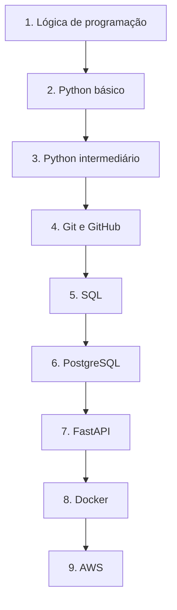

# 🗺️ Roadmap — asklipe Back-End Roadmap

[🏠 Início](README.md) · [📊 Study Tracker](STUDY-TRACKER.md) · [📚 Resources](RESOURCES.md)

> Cada etapa só deve ser marcada como concluída quando o **critério de conclusão** do módulo for cumprido. Tecnologias futuras **não** são apresentadas como conhecimento dominado.

## Visão geral

## Sequência de estudo

| # | Etapa | Módulo | Professor / canal | Depende de | Pronto quando... | Status |
|---|-------|--------|-------------------|:----------:|------------------|:------:|
| 1 | Lógica de programação | [01](01-programming-logic/README.md) | Gustavo Guanabara | — | Escrevo algoritmos com condições e repetições. | ⬜ |
| 2 | Python básico | [02 · Mundo 1](02-python/world-01/README.md) | Gustavo Guanabara | 1 | Resolvo os exercícios do Mundo 1 sozinho. | ⬜ |
| 3 | Python intermediário | [02 · Mundos 2 e 3](02-python/README.md) | Gustavo Guanabara | 2 | Uso estruturas compostas, funções, módulos e erros; 4 projetos publicados. | ⬜ |
| 4 | Git e GitHub | [03](03-git-github/README.md) | Gustavo Guanabara | 3 | Versiono tudo e uso branches e pull requests. | ⬜ |
| 5 | SQL | [04](04-sql-databases/README.md) | Bóson Treinamentos | 1 | Escrevo CRUD e `JOIN` e modelo dados. | ⬜ |
| 6 | PostgreSQL | [05](05-postgresql/README.md) | Bóson Treinamentos | 5 | Banco rodando, com índices e integração com Python. | ⬜ |
| 7 | FastAPI | [06](06-fastapi/README.md) | Eduardo Mendes (Dunossauro) | 3, 6 | API com banco, autenticação e testes. | ⬜ |
| 8 | Docker | [07](07-docker/README.md) | Jeferson Fernando / LINUXtips | 7 | API e banco em contêineres com Compose. | ⬜ |
| 9 | AWS | [08](08-aws-cloud/README.md) | Mundo da Cloud | 8 | API publicada na nuvem com custos controlados. | ⬜ |

Legenda: ⬜ não iniciado · 🟦 em andamento · ✅ concluído

## Por que esta ordem?

1. **Lógica antes de Python:** a linguagem fica mais fácil quando o raciocínio já existe.
2. **Git logo após o Python intermediário:** tudo o que vem depois já nasce versionado.
3. **SQL e PostgreSQL antes de FastAPI:** a API precisa de persistência para ser útil.
4. **Docker antes de AWS:** contêineres tornam o deploy na nuvem reproduzível.

## Marcos

- 🏁 **Marco 1 — Programador:** módulos 1 a 4 concluídos e 4 projetos iniciantes publicados.
- 🏁 **Marco 2 — Dados:** módulos 5 e 6 concluídos e CRUD com PostgreSQL publicado.
- 🏁 **Marco 3 — API:** módulo 7 concluído com API de autenticação publicada.
- 🏁 **Marco 4 — Produção:** módulos 8 e 9 concluídos e API publicada na nuvem.

## Revisão

Reavalie este roadmap a cada marco. Se uma etapa exigir mais tempo, ajuste a ordem aqui e registre o motivo no [Study Tracker](STUDY-TRACKER.md).
